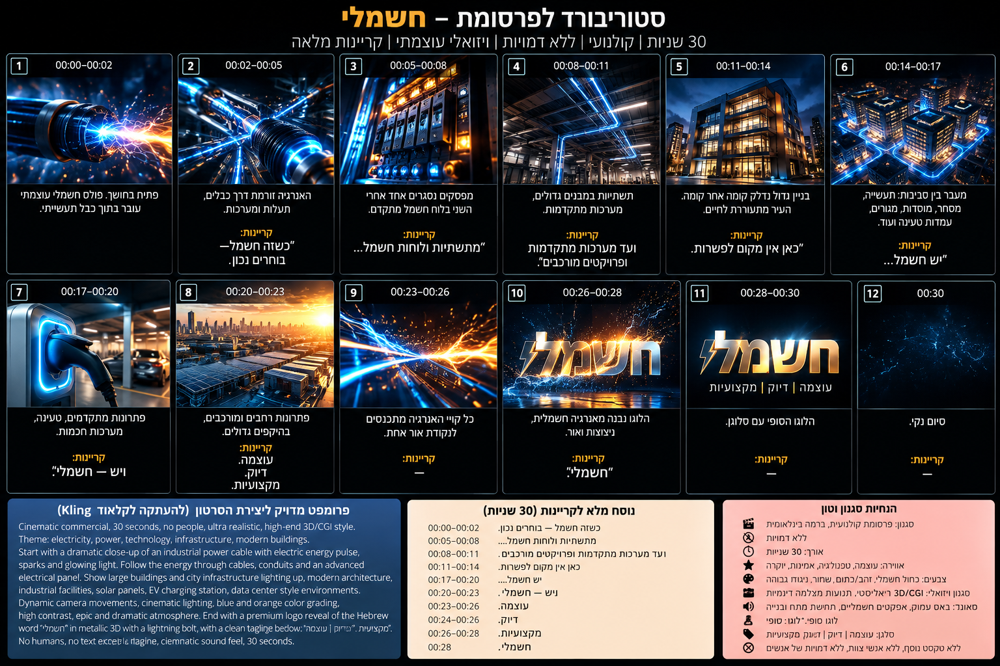

# חשמלי — פרומפטים, קריינות וסאונד

חבילת הקריאייטיב של הפרסומת: פרומפט המאסטר, הפרומפטים ל-Kling שוט אחרי שוט, נוסח הקריינות והנחיות הסאונד.
הגרסה המונפשת שבריפו (`index.html` ו-`dist/heshmali-ad-30s.mp4`) בנויה לפי אותו תסריט ואותם תזמונים, כך שאפשר להשתמש בה כאנימטיק או כגרסה סופית.



---

## 1. פרומפט מאסטר ל-Claude

צור פרסומת קולנועית בינלאומית, עוצמתית ויוקרתית באורך כ־30 שניות למותג החשמל הישראלי ״חשמלי״.

**המטרה:** שהסרטון ירגיש כמו קמפיין בינלאומי של חברת אנרגיה, תשתיות וטכנולוגיה גדולה, ולא כמו פרסומת רגילה של חשמלאי.

אין להציג אנשים, חשמלאים, ידיים או פנים. הסרטון כולו מבוסס על חשמל, אנרגיה, תשתיות, לוחות חשמל, מבנים גדולים, מערכות מתקדמות, תאורה, עמדות טעינה ותנועה קולנועית של אנרגיה.

**אווירה:** דרמטית, יוקרתית, חזקה, טכנולוגית, מדויקת ומעט מסתורית.
**צבעוניות:** שחור עמוק, מתכת כהה, כחול חשמלי, נגיעות אור חמות וזהובות.

**מהלך:**

1. מסך שחור מוחלט. דממה כמעט מוחלטת. זמזום חשמלי נמוך מאוד שהולך ומתגבר. פתאום — ניצוץ.
2. CUT למאקרו קיצוני של כבל חשמל תעשייתי. פולס אנרגיה כחול־לבן עוצמתי טס בתוך הכבל, ניצוצות זעירים עפים באוויר, המצלמה רודפת אחרי האנרגיה במהירות גבוהה.
   קריינות: ״כשזה חשמל — בוחרים נכון.״
3. האנרגיה נכנסת למערכת חשמל תעשייתית. לוח חשמל מתקדם מופיע מתוך החשכה. המפסקים נסגרים בזה אחר זה — CLACK. CLACK. CLACK. — ועם כל מפסק מערכת נוספת מתעוררת.
4. CUT מהיר: תעלות חשמל ותשתיות נדלקות בגל אור, המצלמה טסה לאורכן כאילו היא חלק מזרם החשמל.
   קריינות: ״מתשתיות ולוחות חשמל...״
5. MATCH CUT: הזרם נכנס לבניין גדול ומודרני בלילה. הבניין חשוך, וקומה אחר קומה נדלקת עד שהמבנה כולו מתעורר.
   קריינות: ״ועד מערכות מתקדמות ופרויקטים מורכבים.״
6. תנועה מהירה דרך כמה עולמות של חשמל: תשתיות תעשייתיות, לוחות מתקדמים, תאורה אדריכלית, עמדת טעינה לרכב חשמלי, מבנה מסחרי, מערכות למוסדות. הכול מחובר באותו קו אנרגיה. הקצב עולה, המוזיקה מתעצמת.
   קריינות: ״כאן אין מקום לפשרות.״
7. CUT TO BLACK. חצי שנייה של שקט. CLICK — מפסק ראשי ענק עולה. BOOM — פולס אנרגיה עצום לאורך הפריים.
   קריינות: ״יש חשמל...״
8. האנרגיה הכחולה והזהובה מתכנסת לנקודה אחת במרכז.
   קריינות: ״ויש — חשמלי.״
9. FLASH. מתוך האור נחשף הלוגו ״חשמלי״: מתכתי, יוקרתי, מדויק. לא ילדותי ולא ניאון פשוט. מתחתיו: **עוצמה | דיוק | מקצועיות**.
   קריינות עמוקה: ״עוצמה. דיוק. מקצועיות.״ פעימה אחרונה, ניצוץ קטן עובר על הלוגו. ״חשמלי.״ CUT TO BLACK.

**סגנון ויזואלי:**
Ultra cinematic commercial, premium international advertising, photorealistic high-end CGI/VFX, realistic electrical infrastructure, macro cinematography, dramatic volumetric lighting, deep blacks, electric blue energy, subtle warm highlights, metallic surfaces, anamorphic lens characteristics, shallow depth of field, realistic sparks, controlled lens flares, dynamic camera movement, extremely detailed, premium industrial technology aesthetic.

**חשוב:** בלי אנשים, בלי דמויות AI ובלי פנים. בלי מראה של סטוק, בלי אפקטי חשמל מצוירים ובלי מראה גיימינג או מדע בדיוני מוגזם. הכול צריך להרגיש מציאותי, יקר, קולנועי ואמין.

---

## 2. פרומפטים נפרדים ל-Kling

> את הלוגו והמילים בעברית עדיף להוסיף בעריכה (CapCut או Canva) ולא לתת ל-Kling לייצר אותם, כדי ש״חשמלי״ יישאר בדיוק הלוגו האמיתי ולא טקסט AI עקום. הלוגו בלי רקע נמצא ב-`assets/logo.png`.

**SHOT 1 — 0:00–0:04**
```
Extreme cinematic macro shot of a massive industrial power cable emerging from complete darkness. A powerful electric energy pulse suddenly ignites inside the cable and races forward, realistic blue-white electrical energy, tiny controlled sparks, metallic textures, dramatic shadows, volumetric atmosphere. Camera rapidly follows the energy through the cable, premium international energy commercial, photorealistic, high-end VFX, anamorphic cinematography, no humans, no hands, no text, no logos, no fantasy look.
```

**SHOT 2 — 0:04–0:08**
```
Seamless cinematic transition from a moving electrical energy pulse into a sophisticated industrial electrical switchboard. Large circuit breakers activate sequentially with powerful mechanical movements, one after another. Each activation illuminates another section of the electrical system. Dark industrial environment, electric blue highlights, subtle warm amber practical lights, realistic metal and electrical components, dramatic cinematic lighting, premium global infrastructure commercial, photorealistic CGI, no people, no text.
```

**SHOT 3 — 0:08–0:12**
```
High-speed cinematic camera flight following a glowing energy pulse through large-scale electrical conduits, cable trays and advanced infrastructure inside a premium industrial facility. The energy travels naturally through the system as sections illuminate in sequence. Highly realistic electrical engineering environment, deep shadows, metallic surfaces, volumetric light, sophisticated blue and warm color contrast, cinematic motion blur, high-end international commercial, no humans.
```

**SHOT 4 — 0:12–0:17**
```
Epic cinematic night shot of a large modern premium commercial building completely dark. A powerful electrical energy pulse enters the building and lights it up floor by floor in a dramatic controlled sequence. Architectural lighting activates, windows illuminate, exterior systems come alive. Camera slowly pulls back and rises to reveal the entire building glowing against the night. Photorealistic architecture, premium energy company commercial, dramatic but realistic, no humans, no text.
```

**SHOT 5 — 0:17–0:22**
```
Fast cinematic montage connected by one continuous electrical energy pulse: advanced electrical infrastructure, premium switchgear, architectural lighting systems, industrial electrical installations, modern EV charging station and a large commercial facility. Use seamless match cuts so the energy appears to travel from one environment into the next. Powerful dynamic camera movement, photorealistic, sophisticated, premium global technology advertising aesthetic, no humans, no text.
```

**SHOT 6 — 0:22–0:26**
```
Extreme close-up of a massive premium industrial main electrical breaker in near darkness. Everything becomes silent and still. The breaker activates with a heavy mechanical CLICK. Immediately a huge controlled wave of electrical energy surges through the system and floods the frame with powerful blue-white light. Cinematic slow motion particles and tiny sparks, intense bass-impact visual feeling, ultra realistic, luxury industrial advertising, no people, no text.
```

**SHOT 7 — 0:26–0:30**
```
Dark cinematic environment. Multiple streams of sophisticated electric blue and subtle warm golden energy travel from different directions and converge precisely in the center of the frame. Massive cinematic energy impact followed by a brief controlled flash. The light settles into an elegant premium hero background designed for a brand logo reveal. Deep black background, metallic atmosphere, subtle particles, high-end global commercial finish, elegant and powerful, photorealistic, no generated text, leave clean centered space for the real logo to be added in post-production.
```

---

## 3. הקריינות הסופית

| זמן בסרטון | פאנל בסטוריבורד | טקסט |
|---|---|---|
| 00:02.25 | 2 | כשזה חשמל — בוחרים נכון. |
| 00:05.25 | 3 | מתשתיות ולוחות חשמל... |
| 00:08.20 | 4 | ועד מערכות מתקדמות ופרויקטים מורכבים. |
| 00:11.85 | 5 | כאן אין מקום לפשרות. |
| 00:14.45 | 6 | יש חשמל... |
| 00:17.52 | 7 | ויש — חשמלי. (״חשמלי״ נוחת על ה-BOOM ב-0:18.5) |
| 00:20.20 | 8 | עוצמה. |
| 00:21.32 | 8 | דיוק. |
| 00:22.44 | 8 | מקצועיות. |
| 00:26.45 | 10 | חשמלי. |

ההקלטה עצמה נמצאת ב-`assets/narration.wav`. הסרטון חותך אותה ל-10 משפטים ומציב כל אחד בפאנל שלו.
התזמונים המדויקים נמצאים גם ב-`dist/narration.srt`, ואפשר לייבא אותו ל-CapCut כמדריך להקלטה.

---

## 4. הסאונד

- **פתיחה:** כמעט שקט. זמזום חשמלי נמוך מאוד, ניצוץ, ואז WHOOSH של הפולס.
- **לוח החשמל:** CLACK. CLACK. CLACK. כבדים ואמיתיים.
- **הבניין:** המוזיקה מתחילה להתרחב עם בס קולנועי ותדרים נמוכים.
- **״כאן אין מקום לפשרות״:** מורידים כמעט הכול.
- **״יש חשמל...״:** שקט.
- **״ויש — חשמלי״:** BOOM גדול, אבל נקי ויוקרתי.
- **חשיפת הלוגו:** בס עמוק, צליל מתכתי קצר וניצוץ חשמלי אחרון.

לא מוזיקת אקשן גנרית. זה צריך להרגיש כמו טריילר יוקרתי של מותג טכנולוגיה ואנרגיה בינלאומי.
