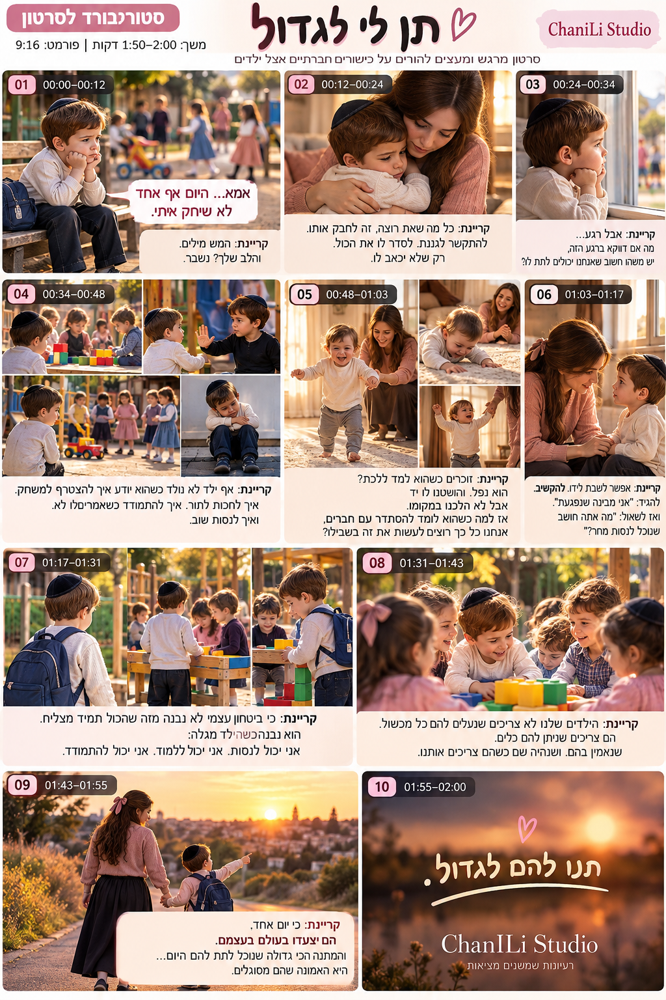

# תן לי לגדול: פרומפטים ליצירת הנכסים

כאן כל מה שצריך כדי ליצור את 23 השוטים, הקריינות, המוזיקה והאפקטים.
שמות הקבצים תואמים ל-`timeline.json`. כשקובץ נשמר בשם ובתיקייה הנכונים, `tools/build.py` משתמש בו אוטומטית.



---

## 0. איך שומרים על אותן דמויות לאורך כל הסרטון

מחוללי וידאו "שוכחים" פנים בין שוט לשוט. לכן העבודה מתחלקת לשני שלבים:

1. **דפי דמות** (פעם אחת): יוצרים במחולל תמונות (Midjourney v7 עם `--cref`, ‏Flux Kontext, ‏Nano Banana או GPT Image) שלוש תמונות ייחוס: הילד, האמא והילד כתינוק. בוחרים את הטובה מכולן ושומרים ב-`reference/char_boy.png`, ‏`reference/char_mom.png` ו-`reference/char_toddler.png`.
2. **לכל שוט:** יוצרים **פריים פתיחה** עם תמונות הייחוס (פרומפט "START FRAME"), ואז מנפישים אותו ב-image-to-video (‏Veo 3.1, ‏Kling 2.5 / 2.6 או Runway Gen-4) עם פרומפט ה-"MOTION".

הגדרות לכל השוטים: **9:16, ‏1080×1920, ‏24fps**. האורך שמופיע ליד כל שוט כבר כולל חצי שנייה התחלתית שנחתכת ואת זמן המעבר.
אם המחולל מייצר גם סאונד (Veo), זה בסדר: הסקריפט מתעלם מהסאונד של הקליפים, והסאונד מגיע מהקריינות, מהמוזיקה ומהאפקטים.

### תיאורי דמויות (להעתיק מילה במילה לכל פרומפט, בלי לשנות)

**BOY**
```
a 5-year-old Israeli boy, short tousled chestnut-brown hair, fair skin with faint freckles on the nose, big hazel-brown eyes, round soft cheeks, a small black velvet kippah, cream cable-knit long-sleeve sweater, dark navy trousers, brown shoes
```
(בגן נוסף לו: `navy-blue kids backpack`)

**MOM**
```
an Israeli mother in her late twenties, long wavy chestnut-brown hair past the shoulders with a small dusty-pink bow clip, warm brown eyes, soft natural makeup, modest dress: dusty-rose knit cardigan with long sleeves over a cream high-neck top, long charcoal pleated skirt reaching the ankles
```

**TODDLER** (לפלאשבק)
```
the same boy at 12 months old, fine light chestnut-brown hair, hazel-brown eyes, chubby cheeks, cream long-sleeve cotton onesie and soft grey pants, barefoot
```

**ילדים ברקע**
```
other Israeli kindergarten children aged 4-6 in modest clothing: girls in long-sleeve dresses or skirts below the knee, some with hair bows; boys with kippot
```

### מקומות

- **GAN_YARD**: `a real Israeli kindergarten yard, sand and rubber flooring, a weathered wooden bench, a colorful wooden play structure, a low wooden table with big plastic building blocks, an olive tree, Jerusalem-stone wall, late-afternoon golden light`
- **HOME**: `a warm Israeli family living room, beige sofa, wooden shelves with books, sheer linen curtains, large window overlooking a playground, soft late-afternoon light`
- **SUNSET_PATH**: `a paved path on a hill with dry golden grass and wild shrubs, overlooking a Jerusalem-stone neighbourhood, the sun low on the horizon`

### סגנון (מוסיפים בסוף כל פרומפט)
```
cinematic family film, photorealistic, shot on ARRI Alexa 35 with vintage anamorphic-look spherical lenses, natural warm light, shallow depth of field, soft film grain, gentle halation, true-to-life skin texture, emotionally authentic subtle acting, international commercial quality, vertical 9:16 composition
```

### נגטיב (לכל שוט, כשהכלי תומך)
```
cartoon, 3d render, CGI look, plastic skin, doll face, deformed hands, extra fingers, morphing faces, face changing between frames, text, captions, logos, watermark, subtitles, slideshow, still image, zoom-only movement, oversaturated, harsh flash, immodest clothing, short sleeves on the mother, uncovered knees
```

---

## 1. סצנה 1 (0:00–0:12): לבד בחצר

**A01: ‏0:00–0:05, צריך 6 שנ׳**
- START FRAME: `GAN_YARD. BOY sits alone at the far end of the wooden bench, chin resting on both hands, backpack beside him. In the soft-focus background, OTHER CHILDREN run and play near the play structure. Medium-wide shot, camera at the boy's eye level, golden backlight rimming his hair.`
- MOTION: `Slow dolly-in toward the boy. Rack focus from the playing children in the background to the boy's face. He watches them, then lowers his eyes. Background children keep moving naturally. Gentle breeze in the olive leaves.`

**A02: ‏0:05–0:12, צריך 8 שנ׳**
- START FRAME: `Extreme close-up of BOY's face in GAN_YARD, chin on his hands, eyes glistening but not crying, blurred children's colors in the background, warm golden rim light, 85mm.`
- MOTION: `Almost still, very slow push-in. He blinks, swallows, his lips press together; a tiny tremble of the chin. Eyes follow something off-screen, then drop down. Shallow focus breathing. Subtle, restrained acting, no tears falling.`

## 2. סצנה 2 (0:12–0:24): החיבוק

**A03: ‏0:12–0:18, צריך 7 שנ׳**
- START FRAME: `HOME. MOM kneels on the rug and hugs BOY tightly, his head resting on her shoulder, her eyes closed, her cheek against his hair. Medium close-up, warm window light from behind.`
- MOTION: `Slow arc around them from behind the boy's shoulder to reveal the mother's face. She holds him a little tighter, takes a slow breath. His small hands grip her cardigan.`

**A04: ‏0:18–0:24, צריך 7.5 שנ׳**
- START FRAME: `Close-up of MOM's face in HOME, still holding BOY (only the back of his head with the kippah visible in the foreground), worried loving expression, a smartphone lying on the side table out of focus.`
- MOTION: `She opens her eyes, glances toward the phone on the table, hesitates, then looks back down at her son. Very slow push-in. Light shifts softly as a curtain moves.`

## 3. סצנה 3 (0:24–0:34): ליד החלון

**A05: ‏0:24–0:29, צריך 6 שנ׳**
- START FRAME: `HOME. BOY stands at the large window, seen from behind and slightly to the side, small hands on the windowsill, looking out at an empty playground in the late light. Silhouette with warm backlight, sheer curtain at the edge of frame.`
- MOTION: `Locked-off camera with an imperceptible push-in. Only the curtain moves slightly; the boy shifts his weight once. Stillness.`

**A06: ‏0:29–0:34, צריך 5.5 שנ׳**
- START FRAME: `Close profile of BOY at the window, his face lit by soft golden light, faint reflection of the playground on the glass, thoughtful expression.`
- MOTION: `He breathes out, a faint fog appears on the glass and fades. His eyes narrow slightly, as if thinking. Slow lateral slide of the camera.`

## 4. סצנה 4 (0:34–0:48): מונטאז׳ בגן

**A07: ‏0:34–0:38.2, צריך 5 שנ׳**
- START FRAME: `GAN_YARD. OTHER CHILDREN build with big plastic blocks at the low wooden table. BOY stands two steps away, watching, one hand half-raised.`
- MOTION: `Handheld, gentle. The boy starts to step forward, stops, lowers his hand. The children keep building without noticing.`

**A08: ‏0:38.2–0:41.4, צריך 4 שנ׳**
- START FRAME: `GAN_YARD. A short line of children waiting to climb the slide; BOY is third in line, impatient, leaning to the side.`
- MOTION: `He shifts restlessly, almost steps out of line, then plants his feet and waits his turn. The child in front climbs up. Camera low, slow push.`

**A09: ‏0:41.4–0:44.8, צריך 4 שנ׳**
- START FRAME: `GAN_YARD. Two children, a boy with a kippah (not the main boy) and a girl in a long dress, both holding the same toy truck, frowning.`
- MOTION: `They tug once, then the girl lets go and points: "you first". The boy nods and hands it back after a moment. Small, natural resolution. Shallow focus.`

**A10: ‏0:44.8–0:48, צריך 4.5 שנ׳**
- START FRAME: `GAN_YARD. BOY sits alone on a low stone curb, knees hugged to his chest, head down.`
- MOTION: `He slowly lifts his head and looks toward the playing children, a small determined breath. Camera slowly rises from low angle to his eye level.`

## 5. סצנה 5 (0:48–1:03): פלאשבק, הצעדים הראשונים

כל שלושת השוטים בתאורה רכה וחמה יותר. הסקריפט מוסיף להם גרייד פלאשבק אוטומטית.

**A11: ‏0:48–0:53, צריך 5.5 שנ׳**
- START FRAME: `HOME, two years earlier, dreamy soft light. TODDLER stands wobbling on a cream rug, arms out, taking his first steps toward MOM, who kneels a meter away with open arms, laughing.`
- MOTION: `The toddler takes three unsteady steps, giggling. Camera at floor level, gently tracking backward ahead of him. Dust motes in the sunbeams.`

**A12: ‏0:53–0:57.5, צריך 5 שנ׳**
- START FRAME: `HOME, soft light. TODDLER sitting down on the rug after a gentle tumble, surprised but smiling. MOM's hand reaches into frame toward him.`
- MOTION: `He lands softly on his bottom (no impact, no crying), looks up and laughs. The mother's hand opens toward him, he grabs her finger and pulls himself up.`

**A13: ‏0:57.5–1:03, צריך 7 שנ׳**
- START FRAME: `HOME, soft light. TODDLER holding MOM's index finger, standing; her face visible behind him, encouraging.`
- MOTION: `He lets go of her finger and walks two steps on his own, arms raised in triumph. The mother does not follow; she stays kneeling and smiles with pride. Camera stays low and still.`

## 6. סצנה 6 (1:03–1:17): בגובה העיניים

**A14: ‏1:03–1:10, צריך 7.5 שנ׳**
- START FRAME: `HOME, evening warm lamp light. MOM sits on the rug at BOY's eye level, his hands held loosely in hers, both in profile facing each other. Medium two-shot.`
- MOTION: `She listens, nods slowly, speaks a few soft words (mouth movement minimal). He looks down, then back up at her. Very slow push-in.`

**A15: ‏1:10–1:17, צריך 8 שנ׳**
- START FRAME: `Over-the-shoulder from behind MOM toward BOY's face, in HOME, warm lamp light, he is thinking.`
- MOTION: `He thinks, his eyes drift up and to the side, then a small shy smile and a tiny nod. Soft rack focus onto his eyes.`

## 7. סצנה 7 (1:17–1:31): מנסה שוב

**A16: ‏1:17–1:21.6, צריך 5 שנ׳**
- START FRAME: `GAN_YARD, morning golden light. BOY with his navy backpack seen from behind at the kindergarten gate, children playing ahead of him.`
- MOTION: `He takes a deep breath (shoulders rise and fall), adjusts his backpack strap and walks in. Steadicam follows behind at his height.`

**A17: ‏1:21.6–1:26.2, צריך 5 שנ׳**
- START FRAME: `GAN_YARD. BOY stands near the block table, watching two children build a tower, attentive, not interrupting.`
- MOTION: `Slow orbit from behind his shoulder to the side of his face. He watches carefully, his eyes follow the blocks, he waits. One child glances at him.`

**A18: ‏1:26.2–1:31, צריך 5 שנ׳**
- START FRAME: `GAN_YARD. Close shot of BOY's hand holding a red block near the tower, the other children's hands nearby.`
- MOTION: `He gently places the red block exactly where the tower needs it. A child looks up and smiles at him. Camera tilts up from the hands to his face lighting up.`

## 8. סצנה 8 (1:31–1:43): ביחד

**A19: ‏1:31–1:37, צריך 6.5 שנ׳**
- START FRAME: `GAN_YARD. BOY and four OTHER CHILDREN crowd around the block table building together, laughing, golden backlight and lens flare.`
- MOTION: `Smooth 180-degree orbit around the table at child height. The kids laugh, hand blocks to each other; the boy is fully part of the group.`

**A20: ‏1:37–1:43, צריך 7.5 שנ׳**
- START FRAME: `Low-angle hero shot from table level: the finished block tower in the foreground, BOY and the children behind it, arms up, celebrating.`
- MOTION: `The kids cheer; the boy turns to a friend and they high-five. Slow push-in, warm flare drifts across frame.`

## 9. סצנה 9 (1:43–1:55): יוצאים לעולם

**A21: ‏1:43–1:49, צריך 6.5 שנ׳**
- START FRAME: `SUNSET_PATH. MOM and BOY (with backpack) walk hand in hand away from camera toward the setting sun, the city below. Wide shot from behind, long shadows.`
- MOTION: `Slow steadicam following behind. They walk in step, the boy swinging their joined hands slightly.`

**A22: ‏1:49–1:55, צריך 7.5 שנ׳**
- START FRAME: `SUNSET_PATH. Side angle: BOY lets go of MOM's hand and walks a few steps ahead on his own, MOM stops and watches.`
- MOTION: `The boy walks ahead confidently, then turns back toward his mother with a big smile and points at the horizon. She smiles with tears of pride. Sun flare blooms. Camera slowly cranes up.`

## 10. סצנה 10 (1:55–2:00): רקע למסך הסיום

**A23: ‏1:55–2:00, צריך 5.5 שנ׳**
- START FRAME: `Empty landscape at sunset: soft out-of-focus fields and a distant still lake, a large glowing sun, warm amber and violet sky. No people, lots of calm negative space in the middle of the frame for a title.`
- MOTION: `Almost still. Gentle drift of light and tiny floating particles, grass swaying softly in the foreground blur.`

הכיתוב ״תנו להם לגדול.״, הלב, קו המכחול ו-"ChaniLi Studio" מתווספים בקוד, כך שאין צורך שהמחולל יכתוב טקסט. אם A23 לא קיים, הסקריפט מייצר רקע שקיעה משלו.

---

## 11. קריינות

### קריינית
- **קול:** אישה בת 30–40, חמה, אימהית, אינטימית, כאילו היא מדברת להורה אחד. לא קריינית פרסומות.
- **קצב:** איטי. הפסקה מלאה אחרי כל נקודה. בשאלות האינטונציה עולה בעדינות ולא בדרמטיות.
- **מיקרופון:** קרוב, חדר שקט, בלי ריוורב. ‏48kHz / 24bit WAV.
- **ElevenLabs:** מודל `eleven_v3` (או `eleven_multilingual_v2`). ‏Stability 40–50, ‏Similarity 75, ‏Style 15–25, ‏Speaker boost פעיל. מייצרים כל שורה בנפרד, וכדי שהאינטונציה תהיה רציפה מעבירים בשדות previous/next text את השורות שלפניה ואחריה.
- **הקלטה אנושית (עדיף):** מקליטים את כל הטקסט ברצף, 3 טייקים, וחותכים לשורות לפי הטבלה.

כל שורה נשמרת כ-`vo/vNN.wav` ומתחילה בדיוק בתחילת המילה, בלי שקט בהתחלה. הזמן בטבלה הוא מתי השורה נכנסת בסרטון. אם הטייק ארוך יותר מהמשוער, `--check` יתריע, ואז מזיזים את `at` ב-`timeline.json`.

| קובץ | נכנסת ב- | טקסט לתצוגה | טקסט ל-TTS (ניקוד במילים בעייתיות) |
|---|---|---|---|
| v01 | 0:01.5 | **(ילד)** אמא... היום אף אחד לא שיחק איתי. | אִמָּא... הַיּוֹם אַף אֶחָד לֹא שִׂחֵק אִיתִּי. |
| v02 | 0:06.6 | חמש מילים. | חָמֵשׁ מִלִּים. |
| v03 | 0:08.4 | והלב שלך? | וְהַלֵּב שֶׁלָּךְ? |
| v04 | 0:10.2 | נשבר. | נִשְׁבָּר. |
| v05 | 0:12.8 | כל מה שאת רוצה, זה לחבק אותו. | כָּל מָה שֶׁאַתְּ רוֹצָה, זֶה לְחַבֵּק אוֹתוֹ. |
| v06 | 0:16.0 | להתקשר לגננת. | לְהִתְקַשֵּׁר לַגַּנֶּנֶת. |
| v07 | 0:17.8 | לסדר לו את הכול. | לְסַדֵּר לוֹ אֶת הַכֹּל. |
| v08 | 0:20.4 | רק שלא יכאב לו. | רַק שֶׁלֹּא יִכְאַב לוֹ. |
| v09 | 0:25.8 | אבל רגע... | אֲבָל רֶגַע... |
| v10 | 0:28.0 | מה אם דווקא ברגע הזה, | מָה אִם דַּוְקָא בָּרֶגַע הַזֶּה, |
| v11 | 0:30.2 | יש משהו חשוב שאנחנו יכולים לתת לו? | יֵשׁ מַשֶּׁהוּ חָשׁוּב שֶׁאֲנַחְנוּ יְכוֹלִים לָתֵת לוֹ? |
| v12 | 0:34.6 | אף ילד לא נולד כשהוא יודע איך להצטרף למשחק. | אַף יֶלֶד לֹא נוֹלָד כְּשֶׁהוּא יוֹדֵעַ אֵיךְ לְהִצְטָרֵף לַמִּשְׂחָק. |
| v13 | 0:38.4 | איך לחכות לתור. | אֵיךְ לְחַכּוֹת לַתּוֹר. |
| v14 | 0:41.6 | איך להתמודד כשאומרים לו לא. | אֵיךְ לְהִתְמוֹדֵד כְּשֶׁאוֹמְרִים לוֹ לֹא. |
| v15 | 0:45.2 | ואיך לנסות שוב. | וְאֵיךְ לְנַסּוֹת שׁוּב. |
| v16 | 0:49.2 | זוכרים כשהוא למד ללכת? | זוֹכְרִים כְּשֶׁהוּא לָמַד לָלֶכֶת? |
| v17 | 0:52.0 | הוא נפל. | הוּא נָפַל. |
| v18 | 0:53.6 | והושטנו לו יד. | וְהוֹשַׁטְנוּ לוֹ יָד. |
| v19 | 0:55.4 | אבל לא הלכנו במקומו. | אֲבָל לֹא הָלַכְנוּ בִּמְקוֹמוֹ. |
| v20 | 0:57.9 | אז למה כשהוא לומד להסתדר עם חברים, | אָז לָמָּה כְּשֶׁהוּא לוֹמֵד לְהִסְתַּדֵּר עִם חֲבֵרִים, |
| v21 | 1:00.5 | אנחנו כל כך רוצים לעשות את זה בשבילו? | אֲנַחְנוּ כָּל כָּךְ רוֹצִים לַעֲשׂוֹת אֶת זֶה בִּשְׁבִילוֹ? |
| v22 | 1:04.0 | אפשר לשבת לידו. | אֶפְשָׁר לָשֶׁבֶת לְיָדוֹ. |
| v23 | 1:06.0 | להקשיב. | לְהַקְשִׁיב. |
| v24 | 1:07.6 | להגיד: ״אני מבינה שנפגעת.״ | לְהַגִּיד: אֲנִי מְבִינָה שֶׁנִּפְגַּעְתָּ. |
| v25 | 1:11.0 | ואז לשאול: | וְאָז לִשְׁאוֹל: |
| v26 | 1:12.4 | ״מה אתה חושב שנוכל לנסות מחר?״ | מָה אַתָּה חוֹשֵׁב שֶׁנּוּכַל לְנַסּוֹת מָחָר? |
| v27 | 1:17.8 | כי ביטחון עצמי לא נבנה מזה שהכול תמיד מצליח. | כִּי בִּטָּחוֹן עַצְמִי לֹא נִבְנֶה מִזֶּה שֶׁהַכֹּל תָּמִיד מַצְלִיחַ. |
| v28 | 1:21.8 | הוא נבנה כשהילד מגלה: | הוּא נִבְנֶה כְּשֶׁהַיֶּלֶד מְגַלֶּה: |
| v29 | 1:24.4 | אני יכול לנסות. | אֲנִי יָכוֹל לְנַסּוֹת. |
| v30 | 1:26.4 | אני יכול ללמוד. | אֲנִי יָכוֹל לִלְמֹד. |
| v31 | 1:28.4 | אני יכול להתמודד. | אֲנִי יָכוֹל לְהִתְמוֹדֵד. |
| v32 | 1:31.6 | הילדים שלנו לא צריכים שנעלים להם כל מכשול. | הַיְּלָדִים שֶׁלָּנוּ לֹא צְרִיכִים שֶׁנַּעְלִים לָהֶם כָּל מִכְשׁוֹל. |
| v33 | 1:35.4 | הם צריכים שניתן להם כלים. | הֵם צְרִיכִים שֶׁנִּתֵּן לָהֶם כֵּלִים. |
| v34 | 1:37.8 | שנאמין בהם. | שֶׁנַּאֲמִין בָּהֶם. |
| v35 | 1:39.4 | ושנהיה שם כשהם צריכים אותנו. | וְשֶׁנִּהְיֶה שָׁם כְּשֶׁהֵם צְרִיכִים אוֹתָנוּ. |
| v36 | 1:43.6 | כי יום אחד, | כִּי יוֹם אֶחָד, |
| v37 | 1:45.2 | הם יצעדו בעולם בעצמם. | הֵם יִצְעֲדוּ בָּעוֹלָם בְּעַצְמָם. |
| v38 | 1:48.4 | והמתנה הכי גדולה שנוכל לתת להם היום... | וְהַמַּתָּנָה הֲכִי גְּדוֹלָה שֶׁנּוּכַל לָתֵת לָהֶם הַיּוֹם... |
| v39 | 1:52.0 | היא האמונה שהם מסוגלים. | הִיא הָאֱמוּנָה שֶׁהֵם מְסֻגָּלִים. |

הנחיות רגש לשורות המרכזיות:
- **v02–v04:** שקט, כמעט לחישה. הפסקה של שנייה לפני ״נשבר.״, ואת המילה עצמה אומרים נמוך וסופי.
- **v09:** עצירה. ״רגע״ נאמר כאילו משהו חדש עלה בראש.
- **v24, v26:** ציטוט אמיתי, כאילו האמא מדברת לילד: רך וקרוב יותר.
- **v29–v31:** כל משפט קצת יותר בטוח מהקודם. המוזיקה בונה מתחתיהם.
- **v37:** המשפט הכי חזק בסרטון, בלי לצעוק.
- **v39:** חיוך בקול, דעיכה רכה.

### קול הילד (v01)
עדיף להקליט ילד אמיתי בגיל 5–6 (בהסכמת ההורים), בטלפון, בחדר עם שטיחים וקרוב לפה. מבקשים ממנו לספר את זה "כאילו היה לך יום עצוב בגן", מקליטים 5–6 טייקים ובוחרים את הטבעי ביותר. אם בכל זאת משתמשים בקול AI, לבחור קול ילד מתוך הספרייה הרשמית של הכלי ולא לשכפל קול של ילד אמיתי.

---

## 12. מוזיקה: `music/score.wav` (120 שניות)

אפשר ליצור ב-Suno או ב-Udio (במנוי שמתיר שימוש מסחרי), לרכוש רישיון ב-Artlist או Musicbed (חיפוש: *emotional piano cello, hopeful build, family*), או להזמין מלחין לפי טבלת הקיוז. המוזיקה צריכה להתחיל בשנייה 0 ולהגיע ל-2:00. הסקריפט מנמיך אותה אוטומטית מתחת לקריינות.

**פרומפט ל-Suno (Instrumental):**
```
Cinematic emotional instrumental score, 72 BPM, D major with minor colors. Opens with sparse intimate solo felt piano, sad and tender. Soft string pad joins. A moment of near silence. Warm solo cello melody enters, then gentle music-box and celesta for a nostalgic memory section. Strings ostinato gradually builds hope, light orchestral percussion and soft wordless choir rise to an uplifting, empowering cinematic climax. Ends with a single soft piano phrase and a long ringing final chord. International commercial, heartfelt, no drums kit, no vocals with words.
```

**טבלת קיוז (למלחין או לעריכת המוזיקה):**

| זמן | מה קורה בתמונה | מוזיקה |
|---|---|---|
| 0:00–0:12 | ילד לבד | פסנתר סולו דליל, עצוב |
| 0:12–0:22 | החיבוק | פד מיתרים רך מצטרף |
| 0:22–0:26 | שקט לפני ״אבל רגע...״ | כמעט שקט: צליל אחד מתמשך |
| 0:26–0:34 | החלון | פסנתר חוזר, שאלה פתוחה |
| 0:34–0:48 | מונטאז׳ | צ׳לו סולו נכנס, דופק עדין |
| 0:48–1:03 | פלאשבק | קופסת נגינה או צ׳לסטה מעל הפסנתר, חם ונוסטלגי |
| 1:03–1:17 | בגובה העיניים | צ׳לו ופסנתר, מתחילה תקווה |
| 1:17–1:31 | מנסה שוב | אוסטינטו מיתרים, בנייה. גל קטן על כל ״אני יכול״ (1:24.4, ‏1:26.4, ‏1:28.4) |
| 1:31–1:43 | ביחד | **השיא**: מיתרים מלאים, מקהלה רכה, כלי הקשה תזמורתיים |
| 1:43–1:55 | שקיעה | נשאר גבוה ורגשי, הרמה על ״בעצמם״ (1:45.2) |
| 1:55–2:00 | מסך סיום | פסנתר יחיד ואקורד אחרון מצלצל |

---

## 13. אפקטים קוליים: `sfx/`

מ-Freesound (רישיון CC0), מספריית אפקטים, או מ-ElevenLabs Sound Effects עם הפרומפטים האלה. כל קובץ שחסר פשוט לא יושמע, והסרטון ייבנה בלעדיו.

| קובץ | פרומפט |
|---|---|
| `amb_kindergarten.wav` | `Outdoor kindergarten yard ambience, distant children playing and chatting, soft birds, light breeze, no close voices, 30 seconds, seamless loop` |
| `kids_laughter_far.wav` | `Distant group of young children laughing and running in a playground, far away, 8 seconds` |
| `kids_laughter_near.wav` | `Small group of 5-year-old children laughing happily together around a table, close and warm, 10 seconds` |
| `amb_home_room.wav` | `Quiet living room room tone, faint distant street, very soft, 30 seconds, seamless loop` |
| `breath_child.wav` | `A young child's shaky soft sigh, close microphone, 2 seconds` |
| `clock_tick_soft.wav` | `Very soft wall clock ticking in a quiet room, 10 seconds` |
| `blocks_clack.wav` | `Large plastic toy building blocks clicking and stacking on a wooden table, 2 seconds` |
| `toddler_giggle.wav` | `A one-year-old baby giggling happily, close, 2 seconds` |
| `toddler_steps_rug.wav` | `Soft bare baby footsteps on a thick rug, slow and wobbly, 4 seconds` |
| `footsteps_gravel_child.wav` | `A small child's sneakers walking on sand and gravel, 4 seconds` |
| `footsteps_path_two.wav` | `An adult and a small child walking together on a paved path outdoors, unhurried, 10 seconds` |
| `amb_evening_birds_wind.wav` | `Golden-hour hillside ambience, gentle warm wind through dry grass, evening birds, distant city hum, 20 seconds` |
